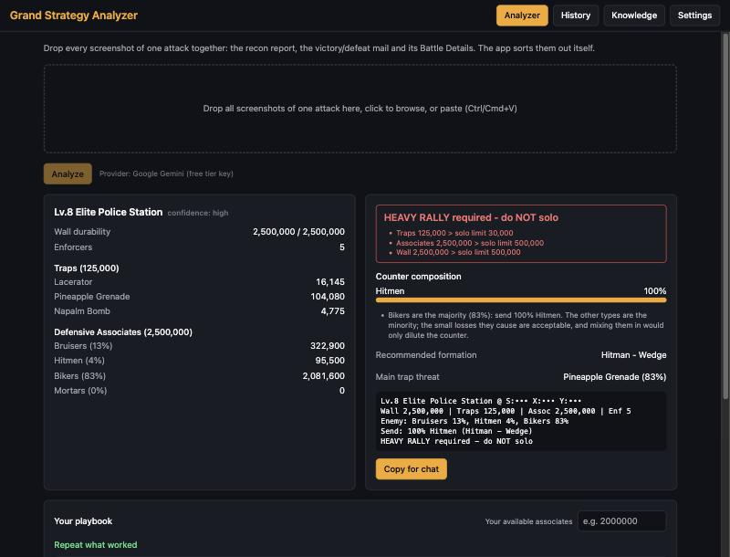
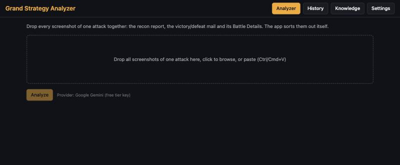
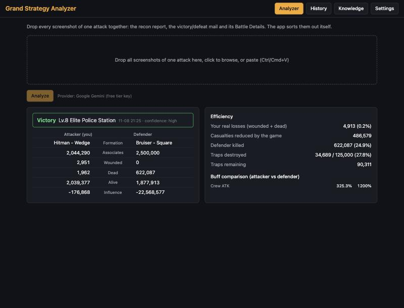
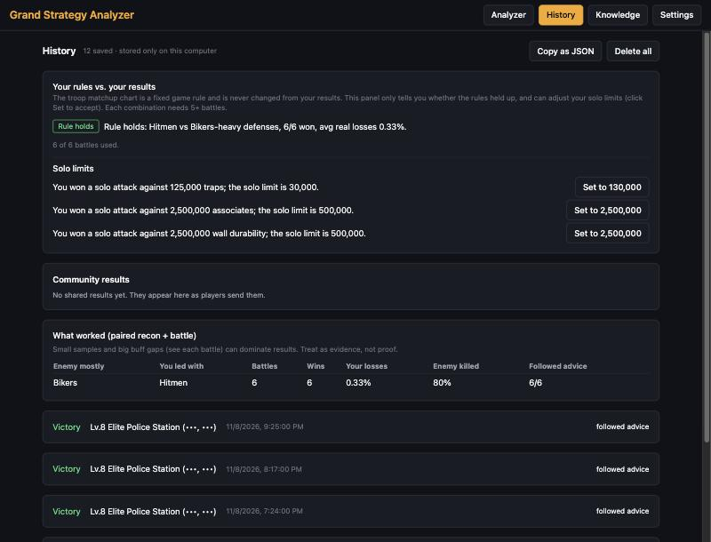

# Grand Strategy Analyzer

**Drop in your Grand Mafia screenshots. Get the best attack in seconds.**

A free desktop app for Windows and Mac that reads your recon reports and battle mails, tells you exactly
what to send, and learns from every fight you win.

[**Use it in your browser**](https://corkapple.github.io/grand-strategy-analyzer/) · [Download the desktop app](../../releases/latest) · [Install guide](docs/INSTALL.md) · [How to use it](docs/USING-THE-APP.md) · [Get a free key](docs/FREE-KEY.md) · [Help](docs/TROUBLESHOOTING.md)

  

Example data. The app shows the defense it read, the troop mix to send, the formation, and whether to attack solo or rally.

---

## What it does

1. **You drop in screenshots** of a recon report and, after the attack, the victory or defeat mail.
2. **The app reads the numbers for you.** No typing. It first reads the screenshots **on your own computer**, and double-checks every number against the game's own totals. Only if something doesn't add up does it ask an AI service.
3. **It tells you what to send:** the troop mix, the formation, and whether to attack solo or call a rally.
4. **It learns from your results.** Every battle you save makes the next suggestion better, and it shows
   what worked for you before against similar defenses.

> **A win is a win.** Small losses are fine. The app only worries when your losses get big (you choose the limit,
> 10% by default).

## See it in action

| 1. Drop your screenshots | 2. Get the attack plan |
|---|---|
|  |  |

| 3. Drop the battle result | 4. Watch it learn |
|---|---|
|  |  |

## What you get

| | |
|---|---|
| **Reads on your computer** | Screenshots are read by your own computer first, with no AI, no key and no internet. Every number is read twice and checked against the game's totals, so a misread digit is caught instead of trusted. |
| **Counter advice** | Bikers beat Bruisers, Bruisers beat Hitmen, Hitmen beat Bikers, and all three beat Mortar Cars. If the enemy is mostly one type, the app tells you to counter it fully (100%). |
| **Right formation** | One of the six real in-game formations, picked for the troop type you are sending. |
| **Solo or rally** | Based on the target's traps, army and wall. |
| **No recon? Send Bikers.** | If a recon fails, the app reminds you: a full 100% Bikers raid. |
| **Your playbook** | Your own past wins against similar defenses, with the army size and losses. |
| **History** | Every recon and battle, paired automatically, with win rates. |
| **Community stats** | Win rates built from everyone's anonymous results (see [Privacy](docs/PRIVACY.md)). |
| **Stays up to date** | Reads game guides from the internet and proposes updates. You approve each one. |
| **Updates itself** | When a new version is ready the app tells you and installs it with one click (Mac). No new download page, no new warnings. |
| **Never stuck** | If one free AI service runs out, the app tries the next one you set up (Gemini, OpenRouter, Groq, GitHub Models). A free community network can read guides with no key at all. |

## Get started in 5 minutes

1. **[Open the web app](https://corkapple.github.io/grand-strategy-analyzer/)** (nothing to install), or **[download and install](docs/INSTALL.md)** the desktop app, which reads screenshots faster and keeps your key in the system keychain.
2. **[Get a free key](docs/FREE-KEY.md)** (about 2 minutes, no credit card) and paste it into Settings.
3. Open the **Analyzer** tab, drop in your screenshots, and click **Analyze**.

That's it. The [full guide](docs/USING-THE-APP.md) explains every screen in plain language.

## Your data and privacy

- Your screenshots are read **on your own computer** first. They go to an AI service you chose (such as Google Gemini or
  OpenRouter) only when the on-device reading can't be verified, and never to us.
- Your history, playbook and keys stay **on your computer**. Keys are kept in your computer's secure keychain.
- The app shares **anonymous numbers only** (enemy troop mix, army sizes, result, losses) to improve the advice for
  everyone. **Never** screenshots, names, coordinates or keys. You can switch it off in Settings, and you can see
  exactly what was sent. Details: [Privacy](docs/PRIVACY.md).

## Need help?

Start with [Troubleshooting](docs/TROUBLESHOOTING.md). It covers the warnings Windows and Mac show on first launch, "rate
limit" errors, and what to do when the AI can't read a screenshot.

## For developers

Source, build steps, architecture and tests: [Developer guide](docs/DEVELOPER.md).

---

*Unofficial fan tool. Not affiliated with the makers of The Grand Mafia.*
