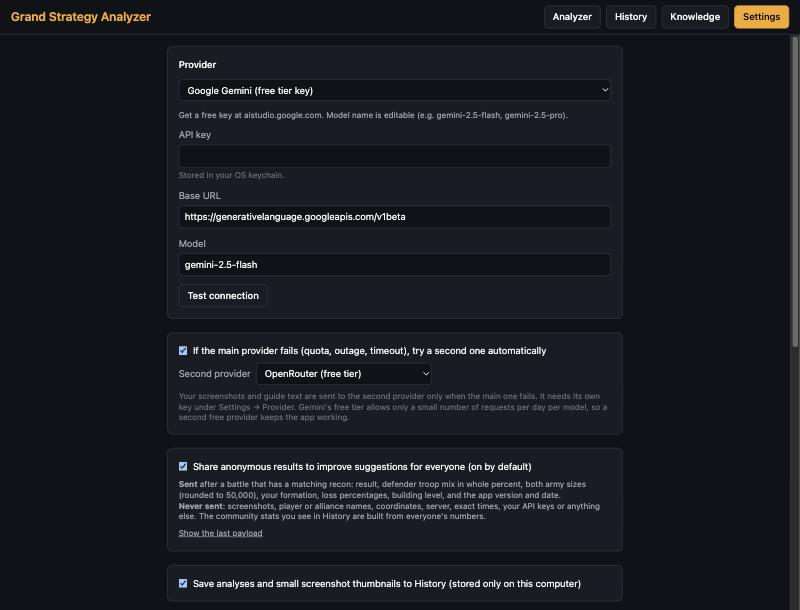

# Get a free key (2 minutes)

The app needs an AI service to read your screenshots. Google Gemini has a free option and is the easiest. You
need a Google account and **no credit card**.

> A "key" is just a long password that lets the app talk to the AI service for you. Keep it private. Don't share it
> or post it anywhere.

## Option 1: Google Gemini (recommended)

1. Open **https://aistudio.google.com/apikey** and sign in with your Google account.
2. Click **Create API key** and copy the key it shows.
3. In the app, open **Settings**.
4. Under **Provider**, choose **Google Gemini (free tier key)**.
5. Paste the key into the **API key** box.
6. Click **Test connection**. It should say it works.

**Limits:** the free plan allows only a limited number of requests per day. If you run out, the app says so. Wait until
tomorrow, or add a second provider below.

## Option 2: OpenRouter (a free backup)

OpenRouter offers several free models. It can be slower and busier, so it works best as a backup.

1. Open **https://openrouter.ai/keys** and create an account.
2. Click **Create Key** and copy it.
3. In the app, open **Settings** and choose **OpenRouter (free tier)** under **Provider**. Paste the key and click **Test connection**.

## Set up an automatic backup (recommended)

If one service is busy or out of requests, the app can switch to the other by itself.

1. Add **both** keys (use the Provider drop-down to switch between them and paste each key).
2. Choose the one you prefer as the main **Provider**.
3. Tick **"If the main provider fails (quota, outage, timeout), try a second one automatically"** and pick the
   other one under **Second provider**.

## Where does my key go?

Your key is stored in your computer's secure keychain (the Mac Keychain or Windows Credential Manager). It is
never uploaded anywhere except to the AI service you chose.

On a Mac, the first time you open a new version, it may ask for your computer password to open the Keychain. Click
**Always Allow**.

## No key at all?

You can still use the app: if analysis fails, click **Finish in a web chat instead**. See
[Using the app](USING-THE-APP.md#if-the-ai-service-is-busy).
