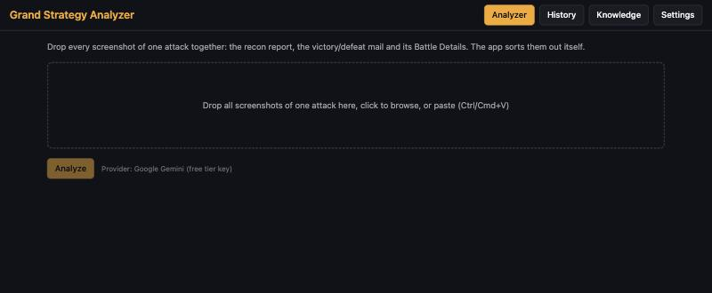
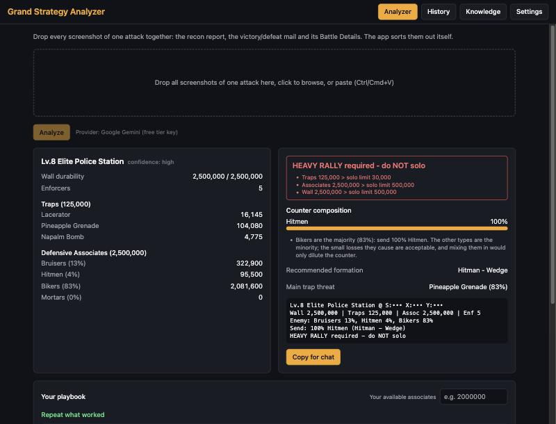
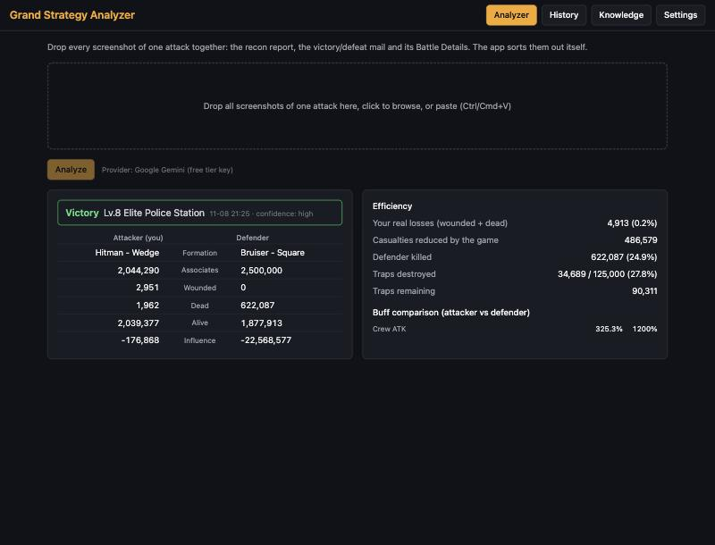
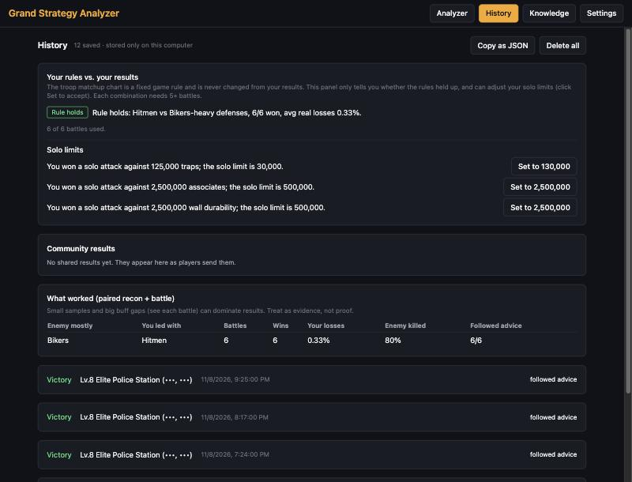
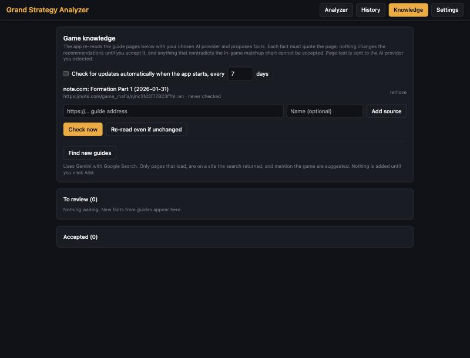
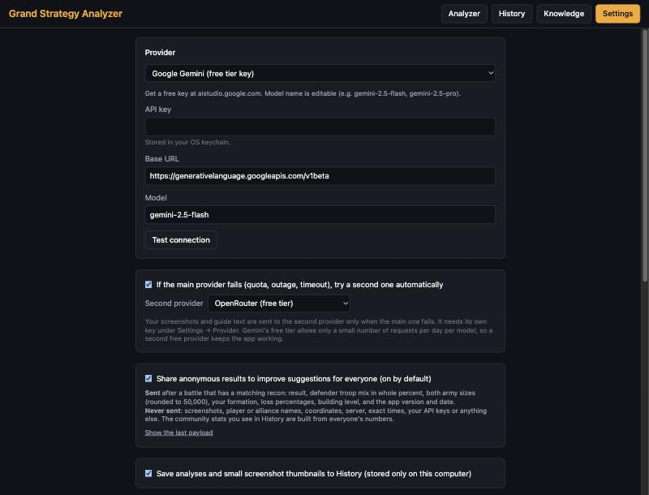

# Using the app

The app has four tabs along the top: **Analyzer**, **History**, **Knowledge** and **Settings**.

## 1. Analyze an attack (Analyzer tab)

**Before the attack: the recon**

1. In the game, send a recon and take a screenshot of the report. You can take more than one if it doesn't fit.
2. In the app, drag the screenshot onto the dotted box. You can also click the box to browse, or paste with
   **Ctrl+V** (Windows) or **Cmd+V** (Mac).
3. Click **Analyze**. In a few seconds you see the defense (troops, traps, wall).

**What the app tells you**
- **The mix to send,** for example "100% Bikers", with the percentage for each type.
- **The formation** to use.
- **Solo or rally:** a green, amber or red message.
- **Your playbook:** your own past wins against similar targets, and how many associates they took.
- **Copy for chat:** a short message you can paste into your game or alliance chat.

*(Example data.)* On the left is the defense the app read. On the right is what to do: the verdict (here, a rally is needed),
the troop mix, the formation, and a message ready to copy into chat.

**If the recon fails** (the target used an anti-recon item), the app says **send a full 100% Bikers raid**.

**After the attack: the result**

1. Open the victory or defeat mail. Take a screenshot of the mail. Also open **Battle Details** and **Buff Comparison**
   if you can, and screenshot those too.
2. Drop **all of them together** into the app and click **Analyze**.

> **Always include the Battle Details screen.** It shows which troops you really sent. Formation names don't say it: for
> example, Bikers are sent in "Hitman - Square". With Battle Details the app records your attack correctly, and History
> and your playbook stay accurate.

You don't have to tell the app what kind of screenshot it is. It sorts them itself. You can even drop the recon and
the battle in one go.

The left side is you, the right side is the enemy. **Your real losses** counts wounded plus dead, the losses that actually
cost you. **Casualties reduced** are the ones the game saved you from.

The app saves the result and pairs it with the recon of the same target. It then tells you what it learned, for example
"Won with 0.2% losses".

**After a battle: how to win next time.** Under the result the app shows what the enemy had and what to send. After a
**defeat** it tells you whether you led with the wrong troops (and names the counter and the formation) or had the right matchup
and simply too few associates. If it can't tell what the enemy had, it falls back to the default full Bikers raid. It also tells you **how many associates to
bring**: the smallest army, as a share of the enemy's, that has won for you before with the right counter and acceptable losses.

**No recon? That works too.** You can send just the victory mail together with its **Battle Details** screen. Battle Details
shows the troops the enemy had, so the app uses that as the enemy mix, and the battle still counts in History, your playbook
and the community stats (History marks it "from Battle Details"). Without Battle Details a battle on its own is still
saved, but the app doesn't know what the enemy had, so it isn't used for the statistics.

Analyzing the **same screenshots again** doesn't add a second copy: the app recognises the same fight and updates its record
(keeping your Solo/Rally label), so your History and the shared statistics don't count it twice.

> **Tip:** take recon and battle screenshots of the **same target close together**. The app matches them by the
> target's coordinates and the time.

## How the app reads your screenshots

1. **On your computer, first.** The app reads the text in each screenshot itself (your Mac's or Windows PC's built-in text
   reader). It reads every screenshot twice and checks the numbers against the game's own totals: a recon's troops
   must add up to "Defensive Associates", and a battle's numbers must add up too.
2. **If everything matches,** you get the result straight away. The result says **"on-device reader (verified)"**. No AI
   service is used, and nothing leaves your computer.
3. **If a number doesn't match,** the app asks your AI service (Gemini and so on), exactly as before.
4. **If every AI service is unavailable,** the app still gives you its best reading, marked **"unverified"**. Check those
   numbers against your screenshot before relying on them.

You can turn the first step off in **Settings → "Read screenshots on this computer first…"**.

## 2. History tab

Everything you have analyzed, newest first, with small thumbnails.

- **Battles are paired with the recon** that came before them.
- **Your rules vs. your results** compares the advice with what actually happened for you. It suggests changes only
  after 5+ battles of the same kind, and **never changes anything until you click Apply**.
- **Community results** shows win rates from all players' anonymous results.
- For each battle you can mark it **Solo** or **Rally**, which helps the app tune the solo limits.
- **Copy as JSON** and **Delete all** are at the top. Delete all asks you to confirm.

## 3. Knowledge tab (optional)

The app can read game guides from the internet and suggest updates to its advice. It checks the pages in your list
about once a week, or when you click **Check now**.

- **Nothing changes until you click Accept** on a suggestion.
- Each suggestion shows the exact sentence from the guide it came from.
- Suggestions that contradict the in-game strengths and weaknesses chart are marked in red and can't be accepted.
- **Find new guides** searches the web for more pages (needs a Gemini key). Nothing is added until you click **Add**.

## 4. Settings tab

- **Provider** and **API key**: see [Get a free key](FREE-KEY.md).
- **Read screenshots on this computer first:** on by default. See "How the app reads your screenshots" above.
- **Second provider:** the automatic backup.
- **Share anonymous results:** on by default. See [Privacy](PRIVACY.md).
- **Save analyses to History:** on by default.
- **Playbook: acceptable losses:** how big your losses can be before a win counts as "costly". 10% by default.
- **Solo-attack thresholds:** how large a target must be before the app suggests a rally. You can leave these.

## If the AI service is busy

Free services sometimes say "rate limit" or time out. The app first tries your second provider. If everything is
busy:

1. Click **Finish in a web chat instead (copy prompt)**.
2. Click **Open Gemini chat** (or OpenRouter, DeepSeek or Mistral Le Chat). Your web browser opens the chat.
3. Paste (Ctrl/Cmd+V). The instructions are already copied.
4. Click **Copy all screenshots as one image** in the app, then paste that into the chat as well.
5. Send it. When the AI answers, copy its reply, paste it into the app's box, and click **Parse reply**.

## Good habits

- Take **clear, full screenshots** and crop out chat overlays if you can.
- Drop the **battle screens of one fight together** (mail + Battle Details + Buff Comparison).
- Always do a **fresh recon before each attack** on the same target. After an attack the defense changes, so the app
  won't reuse an old recon.
- Remember: **a win is a win.** Look at your losses over many battles, not one.
